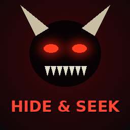

  

<h1 align="center">Hide And Seek Monster</h1>

  <b>Hide &amp; Seek for R.E.P.O. – the seeker becomes a real monster of the game.</b>  
  
  
  

  <a href="https://thunderstore.io/c/repo/p/Napguin/HideAndSeekMonster/"><b>⬇️ Download on Thunderstore</b></a> ·
  <a href="#installation">Installation</a> ·
  <a href="#how-to-play">How to play</a> ·
  <a href="#special-abilities">Specials</a> ·
  <a href="#configuration">Config</a>

---

## Installation

**With a mod manager (recommended):** install
[**Hide And Seek Monster** on Thunderstore](https://thunderstore.io/c/repo/p/Napguin/HideAndSeekMonster/) with r2modman or the Thunderstore Mod Manager –
BepInEx is installed automatically.

**Manually:**
1. Install [BepInEx](https://thunderstore.io/c/repo/p/BepInEx/BepInExPack/) for R.E.P.O.
2. Download the latest zip from [`release/`](release/) and copy
   `BepInEx/plugins/HideAndSeekMonster/HideAndSeekMonster.dll` into `<REPO>/BepInEx/plugins/`.

A **Hide & Seek** game mode for R.E.P.O. where the seeker **becomes a real monster of the game**.

One player turns into a monster – e.g. a Huntsman, Robe, Trudge, … (taken from the game's own enemies).
Everyone else has a short time to hide. Then the monster is released and hunts them down.

> **Every player in the lobby needs this mod installed.**

## How to play

1. Start a run and enter a level.
2. The **host** presses **F8** to open the Hide & Seek menu.
3. Pick the **seeker** (a player or Random) and the **monster** (a monster or Random).
4. Adjust times, attack range, speed and monster size if you like.
5. Press **Start round**.

### As the monster
| Control | Action |
|---|---|
| **Left mouse** | Attack – lunge forward, 40 damage to hiders in front of you (players have 100 HP) |
| **Right mouse** / **R** | Player scan – shows how many players are within 15 m (not where); those hiders get warned |
| **Middle mouse** / **F** | Special ability (see below) |
| **V** | Switch between third person (see your monster) and first person |

During the hiding phase the seeker can pick which monster they want to be.
The monster is faster, has infinite stamina and is invincible. It can grab things, so doors and buttons work.
Running into hiders does nothing – the monster has to hurt them with its attack or special.

### Test mode (solo)
Enable **Test mode** in the F8 menu (or `Test / TestMode` in the config) and start a round alone.
You become the monster, training dummies stand around you as hiders, hiding time is only 3 s and there are no cooldowns.

| Key | Action |
|---|---|
| **F9** / **Shift+F9** | Next / previous monster model |
| **F10** | Spawn a dummy in front of you |
| **F11** | Toggle the debug overlay |

The overlay shows the monster's model info and whether your last attack hit (distance and angle).
Details are also written to `BepInEx/LogOutput.log`. Dummies only exist on the host's screen.

### Special abilities
Every monster has one special (**middle mouse** / **F**). The ability bar at the bottom shows the cooldowns.

| Special | What it does | Monsters |
|---|---|---|
| Laser | 3 s beam, 25 damage every 0.5 s, walls block it; the Clown can't move while firing | Clown |
| Shot | one long-range shot, 60 damage to the first hider in the line of fire | Huntsman |
| Rapid Charge | 1.5x speed for 5 s with a visible aura, 20 damage every 0.5 s to hiders close by, no main attack meanwhile | Robe, Reaper, Animal |
| Flying Charge | attack form, fly for 6 s (space up, ctrl down), 10 damage every 0.5 s to hiders close by | Apex Predator |
| Leap attack | big jump forward, 40 damage to anyone hit | Headman, Headgrab, Upscream, Snatcher, Chef, Tick |
| Radar Ping | position and distance of every hider within 30 m for 1 s (2 min cooldown); hiders are told whether they were detected | Peeper, Loom, Elsa |
| Flying Grab | invisible bubble (4 m) around the monster: hiders inside are stunned for 4 s, no main attack meanwhile. The Oogly can always fly | Oogly |
| Zero-G Grab | stun bubble (6 m) with zero gravity: hiders inside float and are stunned for 4 s, no main attack meanwhile | Mentalist |
| Throw | projectile in an arc, 40 damage on hit | Rugrat, Birthday Boy |
| Head bomb | throws its head – it bounces off walls and explodes after 4 s: explosion (50 damage, 4 m) and a uranium cloud (10 damage every 0.5 s for 5 s) | Cleanup Crew |
| Puke | vomit stream forward for 2.5 s: 10 damage every 0.5 s and slows. The Spewer can always fly | Spewer |
| Scream | hiders within 10 m are pushed away and slowed for 2.5 s | Bowtie, Bella |
| Ground slam | wind-up, then 50 damage within 5 m and knock-back | Trudge |
| Heart gas | hiders within 12 m are pulled towards the monster for 3 s | Heart Hugger |
| Gamble | a random special | Gambit |

Hiders see which special the monster has while they hide and get a warning when it is used.

### Scores
Points add up over all rounds. They are shown after each round and in the F8 menu (the host can reset them).
- **Monster:** 1 point per hider killed.
- **Hiders:** the hider who lasts longest gets as many points as there were hiders, the next one 1 less, and so on –
  the first hider eliminated gets 0. Everyone still alive at the end gets the full points.
  Example with 3 hiders: Anna eaten first (0), Ben second (2), Carl survives (3).

### Phases
| Phase | What happens |
|---|---|
| **Hiding** | The monster is frozen and its screen is black. Hiders run and hide. |
| **Hunting** | The monster is released and hunts. |
| **End** | The monster wins when every hider is dead. The hiders win if at least one survives the hunt timer. |

Normal enemies are despawned while a round is running (can be turned off).

## Configuration
`BepInEx/config/HideAndSeekMonster.cfg` (created after the first start).
The round settings of the **host** are used for everyone.

| Setting | Default | Description |
|---|---|---|
| General / MenuKey | F8 | Key to open the menu |
| General / Language | English | English or Deutsch |
| Round / HideTime | 30 | Seconds to hide |
| Round / RoundTime | 300 | Seconds the monster has to hunt |
| Round / DisableEnemies | true | Despawn normal enemies during a round |
| Seeker / AttackRange | 2.8 | Reach of the attack in metres |
| Seeker / AttackCooldown | 1.2 | Seconds between attacks |
| Seeker / AttackDamage | 40 | Damage of the main attack |
| Seeker / ScanCooldown | 20 | Seconds between player scans (roar) |
| Seeker / ThirdPerson | true | Start in third person |
| Seeker / CameraDistance | 3.2 | Third-person camera distance |
| Seeker / SpeedMultiplier | 1.35 | Monster movement speed |
| Seeker / InfiniteStamina | true | Monster never runs out of stamina |
| Seeker / Invincible | true | Monster can't be damaged |
| Seeker / BlindWhileHiding | true | Black screen for the monster while the others hide |
| Seeker / MonsterScale | 1.0 | Size of the monster model |
| Round / SeekerChoosesMonster | true | Seeker picks their monster while the others hide |
| Seeker / CanGrab | true | Monster can grab (needed for doors) |
| Seeker / LaserDuration | 3 | Seconds the laser fires |
| Seeker / LaserCooldown | 12 | Seconds between lasers |
| Test / TestMode | false | Solo test mode with training dummies |
| Test / DummyCount | 4 | Dummies spawned around you in test mode |
| Controls / Attack, Roar, ToggleView | mouse L / mouse R / V | Input System paths, e.g. `<Keyboard>/f` |

## Bugs & ideas
Found a bug or have an idea for a monster's special? Open an
[issue](https://github.com/Napguin/REPO-Monster-Hide-and-Seek/issues) – a `BepInEx/LogOutput.log` from your mod
manager profile helps a lot.

## Development
- Changelog: [`thunderstore/CHANGELOG.md`](thunderstore/CHANGELOG.md)
- Build & publish guide: [`BUILD.md`](BUILD.md) – zips in `release/` are published to Thunderstore automatically,
  test builds of the `beta` branch go to `test-builds/`.
